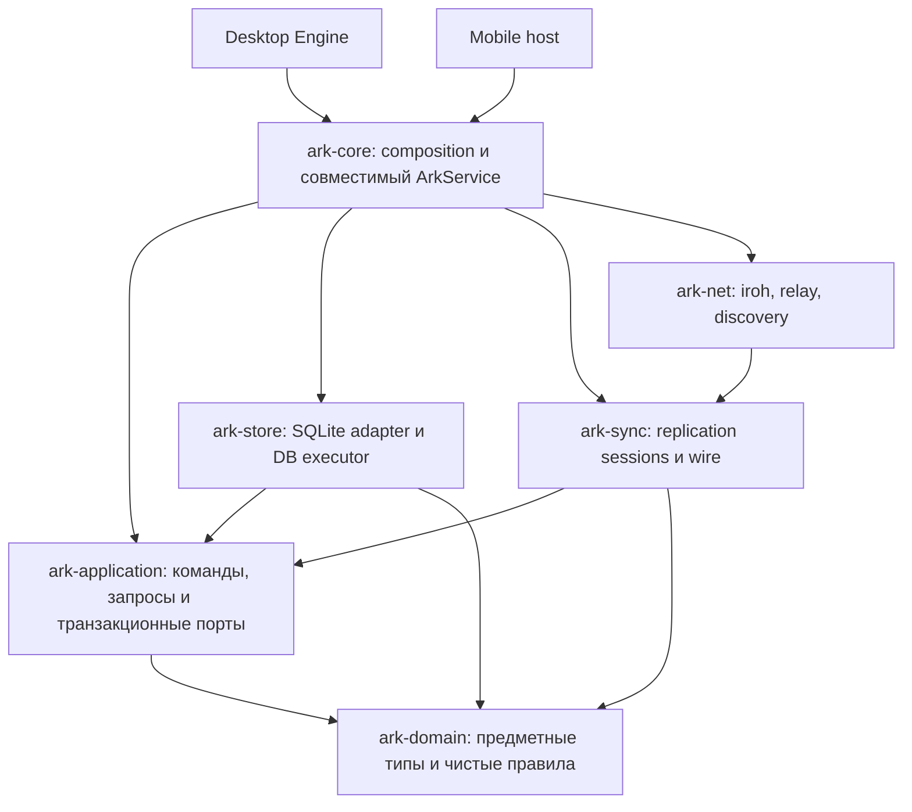

# Cortex / ARK: архитектура с проверяемыми гарантиями

Дата: 15 октября 2026. Статус: продуктовые требования согласованы; реализация идёт отдельными проверяемыми этапами.
Эпик: KOS-412.
Проверенная база: `makekosmos/cortex`, `ba8a9dfa977e8b0af80046bb4124bc8decb3070a`.
Наблюдения ниже относятся к указанному исходному commit. Целевые гарантии не считаются реализованными до проверки соответствующего этапа.

## 1. Главный вывод

Сохранить Cortex как модульный монолит: Engine владеет привилегированными возможностями, ARK выполняется внутри процесса, SQLite остаётся основным хранилищем. Разделять ответственность, направление зависимостей и жизненный цикл; процессы выделять там, где уже нужна изоляция сторонних workers.

Уточнённая продуктовая модель: Cortex — unified personal exocortex, одно пространство данных человека, одна локальная БД на каждом его устройстве. Рабочие/личные категории и приложения — представления и способы работы с этими данными. Совместная работа приложения и обмен выбранными объектами не создают обязательную иерархию tenants/workspaces в ядре.

Шесть крейтов из исходного предложения — разумная отправная точка, но деление по папкам не определяет семантику системы. Центральная недостающая часть — прикладной слой, который одинаково проводит локальные и входящие изменения через авторизацию, проверку контрактов и атомарный commit.

«Никогда ничего не переделывать» гарантировать нельзя: ещё неизвестны реальные пределы объёма данных, числа peers и задержек. Можно заранее стабилизировать дорогие контракты: идентичность, транзакции, порядок изменений, совместимость протокола, восстановление и права доступа. Остальные решения оставить заменяемыми внутри модулей.

## 2. Что действительно обнаружено в свежем коде

| Наблюдение | Доказательство | Следствие для проекта |
|---|---|---|
| `StorageBackend` объявлен в `sync_server`, содержит async-методы хранения, проверки transport identity, signed frames и фильтрации | [sync_server.rs, строка 50](https://github.com/makekosmos/cortex/blob/ba8a9dfa977e8b0af80046bb4124bc8decb3070a/core/crates/ark-core/src/sync_server.rs#L50) | Простое перемещение этого трейта в `model` перенесёт туда связанные обязанности |
| SQL-слой импортирует этот трейт и canonical migrations | [db/open.rs](https://github.com/makekosmos/cortex/blob/ba8a9dfa977e8b0af80046bb4124bc8decb3070a/core/crates/ark-core/src/db/open.rs#L10) | Зависимости уже проходят между хранением, прикладными правилами и sync |
| В `db` десять production-файлов `integration_replication_*`; в `integration_replication/signed_sync.rs` есть SQLite и replay reservation | [db.rs](https://github.com/makekosmos/cortex/blob/ba8a9dfa977e8b0af80046bb4124bc8decb3070a/core/crates/ark-core/src/db.rs), [signed_sync.rs](https://github.com/makekosmos/cortex/blob/ba8a9dfa977e8b0af80046bb4124bc8decb3070a/core/crates/ark-core/src/integration_replication/signed_sync.rs#L173) | Перенос всех replication-файлов в одну папку не разделит policy и persistence |
| `canonical_types` содержит определения, validation, SQL-фасады и выполнение миграций; registry вызывает pending replay | [canonical_types/mod.rs](https://github.com/makekosmos/cortex/blob/ba8a9dfa977e8b0af80046bb4124bc8decb3070a/core/crates/ark-core/src/canonical_types/mod.rs), [type_registry/part01.rs](https://github.com/makekosmos/cortex/blob/ba8a9dfa977e8b0af80046bb4124bc8decb3070a/core/crates/ark-core/src/type_registry/part01.rs#L250) | Связанность не ограничивается двумя упомянутыми в предложении случаями |
| Service requests идут через FIFO, но sync применяет изменения через `spawn_blocking` и mutex общей connection | [service.rs](https://github.com/makekosmos/cortex/blob/ba8a9dfa977e8b0af80046bb4124bc8decb3070a/core/crates/ark-core/src/service.rs#L240), [backend/part3.rs](https://github.com/makekosmos/cortex/blob/ba8a9dfa977e8b0af80046bb4124bc8decb3070a/core/crates/ark-core/src/db/backend/part3.rs#L216) | Один процесс и mutex не означают одну очередь команд или общий FIFO для всех writers |
| Очередь service неограниченная; event bus глобальный для процесса, capacity 1024 | [service.rs](https://github.com/makekosmos/cortex/blob/ba8a9dfa977e8b0af80046bb4124bc8decb3070a/core/crates/ark-core/src/service.rs#L240), [events.rs](https://github.com/makekosmos/cortex/blob/ba8a9dfa977e8b0af80046bb4124bc8decb3070a/core/crates/ark-core/src/events.rs) | Нужны backpressure, адресность событий и восстановление после пропусков |
| Включены WAL и `synchronous=NORMAL` | [db/open.rs](https://github.com/makekosmos/cortex/blob/ba8a9dfa977e8b0af80046bb4124bc8decb3070a/core/crates/ark-core/src/db/open.rs#L33) | Успешный commit сейчас нельзя безоговорочно описывать как сохранность при потере питания |
| `engine-mobile` действительно использует `ArkService` и pairing/sync | [engine-mobile/src/lib.rs](https://github.com/makekosmos/cortex/blob/ba8a9dfa977e8b0af80046bb4124bc8decb3070a/runtime/crates/engine-mobile/src/lib.rs) | Mobile нужен sync; убрать ему всю сеть было бы ошибкой |

Пересчёт `part\d` по именам Rust-файлов: 56 в `ark-core/src`, 80 во всём `ark-core` с тестами вне `src`. Число «75» не воспроизводится на этой базе при таком определении. Лимит 300/500 строк подтверждён; история причин появления каждого файла отдельно не исследована.

`include!` — текстовое включение. `db/backend/{part1,part2,part3}.rs` составляют один модуль; новое имя файла само по себе не ограничит доступ к общим деталям.

Cargo запрещает циклы между крейтами, но внутри одного крейта не предотвращает подобную связанность модулей. Нельзя утверждать, что перенос двух групп файлов автоматически очистит весь граф.

## 3. Cortex целиком: три вида ответственности

1. **Host / Engine.** Жизненный цикл приложения, Engine API, аутентификация клиентов, права пакетов, запуск workers, OS adapters, keychain, диктовка, индексы, обновления. Desktop- и mobile-host собирают подходящие возможности.
2. **ARK.** Предметные данные, контракты типов, запросы, атомарные изменения, история для репликации, обработка входящих изменений и восстановление хранилища.
3. **Клиенты и пакеты.** Manager, Agenda и другие приложения используют разрешённые операции Engine. Сторонние workers работают через broker с ограниченными полномочиями. Connection, произвольный SQL и привилегированные OS handles им не выдаются.

Изменение границ ARK не должно незаметно пересматривать permissions пакетов, процессную изоляцию, хранение секретов и жизненный цикл Engine. Публичные signed envelopes содержат зашифрованные credential payloads; plaintext и приватные ключи остаются у владельца secrets в host.

`ArkHost` сейчас находится в `engine-packages`, хотя используется как общая связь с ARK. Целевое место — адаптер host/composition, от которого package-модуль получает узкие разрешённые операции. Вынос оправдан устранением конкретной обратной зависимости, а не созданием ещё одного общего `engine-common`.

## 4. Целевые модули и зависимости

Стрелка означает Cargo-зависимость, а не направление сетевого запроса.



| Модуль | Ответственность | Чего в нём нет |
|---|---|---|
| `ark-domain` | Идентификаторы, объекты, HLC/сравнение ревизий, определения и validation типов, чистые правила grants/conflicts | SQL, transport DTO, Tokio, keychain, глобальный event bus |
| `ark-application` | `ApplyLocal`, `ApplyRemote`, регистрация типов, query-планы, миграционные сценарии; порты транзакции, чтения и committed feed | rusqlite, iroh, raw SQL, OS discovery |
| `ark-store` | Реализация транзакционных портов, физическая схема/миграции, индексы/FTS, snapshot/backup, inbox/outbox, исполнитель DB | Выбор получателей по бизнес-политике, сетевые соединения, решение о допустимости доменного перехода |
| `ark-sync` | Anti-entropy, signed envelope codec, negotiation, sessions, ACK/retry, преобразование wire в application-команды | SQLite connection, собственный путь записи мимо application, сокеты конкретного транспорта |
| `ark-net` | iroh, WebSocket relay, beacon/discovery, framing и transport authentication context | Доменные разрешения на запись и собственная конфликтная политика |
| `ark-core` | Сборка зависимостей, конфигурация, lifecycle, совместимый JSON adapter `ArkService` | Новые предметные правила, SQL, альтернативные write paths |

Названия ориентировочные. Не нужно сразу создавать все крейты: сначала настоящие Rust-модули и ограниченная видимость; затем физические крейты по готовым интерфейсам.

### Почему нет отдельного `ark-schema` в этом первом графе

Под одним словом сейчас скрыты три разные вещи:

- контракт объекта, его нормализация и validation — `domain`;
- физическая версия SQLite, таблицы, индексы — `store`;
- преобразование существующих пользовательских данных и replay — сценарий `application` через транзакционный порт, с чистым преобразованием в `domain`.

Отдельный `ark-schema`, который зависит от store, не решит проблему, если store должен вызвать его для validation записи. Отдельный модуль определений внутри domain достаточен; самостоятельный crate для него нужен при реальном независимом использовании.

### Где живёт интерфейс хранилища

Владельцем порта является вызывающий сценарий в `application`, SQLite его реализует. KOS-417 заменяет широкий `StorageBackend` узкими `SyncEntityReadPort`, `SyncEntityMutationPort` и `PeerProgressPort`. Составной `SyncRuntimeStorage` используется только для сборки возможностей runtime; transport identity, authenticated apply и signed integration остаются специализированными контрактами вне обычного entity-read порта. Контракт `ArkService`, схема и wire-форматы не меняются.

Каждый вызов outbound page выполняет один сериализованный DB-запрос, но отдельные страницы не используют закреплённый общий snapshot: записи между вызовами могут изменить последующие страницы. Входящее применение проходит через application operation и синхронный `SyncEntityMutationSession` внутри транзакции адаптера; `rusqlite::Transaction` и соединение через порт не протекают, а сетевой `await` не удерживает эту транзакцию.

KOS-420 добавляет `ark_committed_feed`: monotonically increasing local commit position, отдельно от HLC и origin sequence. Local version-vector/usage writes и remote canonical object apply append a locator in the same SQLite transaction as the revision. Payload остаётся в canonical tables, так что это bounded locator feed, не event log. `CommittedFeedPort` читает fixed high-watermark и coalesced current entity projection одним сериализованным SQLite read; изменение после snapshot не смешивается с payload старой позиции, а cursor ниже retained floor требует resnapshot. Live notifications only wake the durable sender; startup/reconnect and the periodic server drain resume from persisted per-peer applied cursor. The current wire uses one in-flight `LiveChange` and its applied `LiveAck`, without a wire-shape change.

Authenticated apply сначала сохраняет durable inbox identity и payload digest; затем canonical apply переводит receipt в `applied` в той же транзакции, что и object/feed commit. Для live feed identity — существующий wire `change_id` (`ark-feed-v1:<position>`); для legacy entity paths используется детерминированная identity из peer/locator/revision. Повтор с тем же ID и digest становится no-op; повтор того же ID с другим payload отвергается до stale/equal-HLC fast-path. Pending payload ограничен 1 MiB на entity и общим pending cap 10,000 записей / 32 MiB. После applied commit payload удаляется, digest остаётся для replay detection. Live sender держит один item in-flight на peer и сохраняет applied cursor только после текущего applied `LiveAck`; reconnect повторяет тот же ID. Global feed position не считается contiguous inbound watermark: coalescing и selective filtering законно пропускают позиции. Отдельный durable-receipt ACK, too-old negotiation и соответствующая inbound cursor семантика остаются KOS-421. Feed rows сохраняются, чтобы peer без progress row мог начать чтение с начала; receipt compaction требует определённой KOS-428 recovery boundary.

Не запрещать async «для чистоты» во всех интерфейсах. Предметные правила синхронны; ожидание очереди, I/O и shutdown асинхронно. SQLite transaction не держится через сетевой `await`.

## 5. Единственный путь изменения данных

```text
Engine operation / incoming authenticated sync batch
  → typed command + caller context + idempotency identity
  → bounded admission queue
  → DB executor
  → transaction:
       recheck authorization and expected revision
       validate / resolve conflict
       modify objects, links and transactional indexes
       update HLC / vectors / usage sequences / tombstones
       persist replay receipt / idempotency result when applicable
       append committed change information
  → COMMIT
  → commit receipt
  → wake subscribers and sync sender
```

Основные гарантии:

- У application-сценария и store-adapter один согласованный владелец commit/rollback; вложенные операции используют ту же транзакцию, а не открывают независимые commits.
- Локальный write и remote apply используют общие validation и transaction-порты. У remote сохраняются исходная идентичность и ревизия; он не превращается в новое локальное событие бесконечной ретрансляции.
- В production connection принадлежит одному executor. Другие модули не получают `Arc<Mutex<Connection>>`; отдельные read connections доступны только store.
- Порядок фиксации один. Admission контролирует объём и размеры, сохраняет порядок команд внутри источника; между независимыми источниками допускается справедливое планирование с явно описанным контрактом. Sync не должен навсегда вытеснять интерактивные команды.
- Дорогие чтения идут через read snapshots; API read-after-write принимает commit watermark. SQLite допускает одного писателя, это не причина сериализовать все чтения в одной FIFO.
- Прерванный клиентский запрос может уже зафиксироваться. Таймаут не означает rollback; повтор с тем же ключом и тем же payload возвращает прежний результат. Тот же ключ с другим payload отклоняется. Ключ scoped по проверенному principal; `space_id` остаётся только в существующем wire-контракте. Retention и срок безопасного retry документированы.
- Ошибки storage и join не превращаются в пустые данные. Типизированы как минимум validation, permission, conflict, unsupported capability, busy, storage failure, recovery required и outcome unknown.

### KOS-419: контракт DB executor

Production writer connection принадлежит одному выделенному blocking actor-потоку на каждую открытую базу. Этот actor владеет writer connection и авторитетным lifecycle/scheduler state; отдельный arbiter пока не вводится, потому что безопасное прерывание SQLite-вызова всё равно невозможно, а дополнительный протокол completion/wakeup не даёт доказанной продуктовой гарантии. Actor не зависит от Tokio worker, который может ждать результат этой же очереди. Его mailbox и control path должны быть wakeable для новой работы, maintenance, shutdown и owner failure; отмена или deadline могут убрать только ещё не начатую работу и сами по себе не прерывают выполняющуюся SQLite-транзакцию. Service и sync runtime получают только sender и read/snapshot API; `Connection`, `Transaction` и `Arc<Mutex<Connection>>` за границу executor не выходят. Чтение остаётся на отдельных read connections, чтобы очередь записи не блокировала поиск и загрузку экранов.

DB executor не совмещается с последовательным worker `ArkService`. `stop_sync` ждёт завершения client callbacks и server readers; они могут ждать запись в ту же БД. Если остановка выполняется внутри worker, который одновременно исполняет DB-команды, ожидание образует цикл. Поэтому executor продолжает принимать уже допущенные команды во время остановки sync и закрывается только при остановке сервиса: сначала прекращается новый RPC и sync ingress, затем завершаются producers, после этого очередь дренируется и закрывается. Повторный `start_sync` использует тот же DB executor.

В очередь передаётся закрытый enum принадлежащих application/store командам, а не произвольный callback или `RunSql`. Команда несёт уже известный типом класс (`Interactive`, `SyncLive`, `Backfill`, `Maintenance`), проверенный principal, стабильную идентичность повтора, ограниченный payload и канал результата. RPC использует principal приложения или пакета, sync — стабильный ID устройства, обслуживание — системный principal. Приоритет нельзя передать через JSON. Команду нельзя расширить сетевым `await` или блокирующим внешним I/O: executor выполняет только конечную синхронную транзакционную операцию.

Admission учитывает одновременно число команд и байтов; есть предел на одну команду, общий объём и долю одного источника. Резерв атомарно покрывает и лимит, и место для принятой команды в ограниченном ingress, поэтому после сборки команды отправка не может неожиданно отказать из-за отдельного заполненного mailbox. Для RPC глубина и размер проверяются до преобразования входа в owned команду. Для транспорта сначала проверяется длина сырого кадра, затем до декодирования резервируется его допустимый budget, после чего проверяются число записей и максимальный размер каждой. В очередь не кладётся целая неограниченная страница. Вес очереди вычисляется из ограниченного payload, а не заявляется вызывающим произвольным замыканием.

Для каждого источника сохраняется одна FIFO-очередь сквозь классы; класс головы очереди определяет, в каком scheduling lane источник доступен. Это сохраняет причинный порядок и не позволяет более приоритетной поздней команде обогнать раннюю команду того же источника. Порядок фиксируется при успешном принятии в ingress, а не при резерве: строители команд могут завершиться в разном порядке. Admission ограничивает общий и per-source объём и включает команды, принятые в ingress, ожидающие в очередях и выполняющиеся. Интерактивная запись имеет зарезервированную ёмкость, а sync гарантированную долю обслуживания, чтобы ни один класс не вытеснял другой постоянно. Источник берётся из локального контекста или уже аутентифицированного peer; число активных источников и метаданных планировщика тоже ограничено. Если лимит источников исчерпан, новые источники получают backpressure или отказ — их нельзя сливать в общий lane, где один источник смог бы вытеснить другой. Алгоритм расписания выбирается реализацией при сохранении этих наблюдаемых гарантий. Справедливость действует между ограниченными командами, а не внутри долгой транзакции: большие sync/import делятся на ограниченные batch до admission. Restore, миграция и reset получают эксклюзивный lifecycle barrier, потому что их нельзя безопасно вытеснить посреди SQLite операции.

Lifecycle executor: `Opening → Migrating → Ready → Draining → Closed`; `Recovering` и `Failed` являются явными состояниями и отклоняют новые записи. У состояния один владелец — actor; из `Recovering` допускается только контролируемое восстановление, после которого actor переходит в `Ready` или `Failed`. До `Ready` запись не принимается. Bootstrap/migration connection передаётся executor до перехода в `Ready`; после handoff второго production writer нет. Shutdown закрывает admission и ограничивает ожидание deadline. Команды из очереди, которые не начали исполняться, получают `CancelledBeforeStart`. Текущая транзакция не отменяется посередине: если к deadline её исход неизвестен, вызывающий получает `OutcomeUnknown`, а executor остаётся в `Draining`/`Recovering`, пока не сможет безопасно завершить соединение. Если вызывающий потерял ответ после начала выполнения, результат также `OutcomeUnknown`, а не обещание rollback. Каждая мутация, для которой требуется restart-safe retry, обязана иметь стабильный scoped key и canonical payload hash; перед cutover для каждой команды документируется источник этого key и его срок жизни. Receipt mismatch отклоняется, совпадающий запрос возвращает прежний результат. Отсутствие receipt трактуется как «не применено» только после открытия той же базы и успешного lookup в согласованной точке; любая неопределённость восстановления оставляет исход `OutcomeUnknown`. Срок хранения receipt должен покрывать задокументированное окно повтора; его значение нельзя выбирать без подтверждённого sync/retry horizon. Точная доставка поверх сети не обещается.

Для повтора локальная мутация принимает отдельный необязательный `operationId`. Это поле обозначает намерение повторить ту же запись, а не сетевую попытку. `_req_id`, `DispatchRequest.request_id` и package-worker `CallMessage.id` остаются идентификаторами запроса или ответа и не становятся ключами DB. Для in-process callers с повтором есть типизированный метод, который принимает тот же ID при каждой попытке. Область квитанции определяется проверенным principal, в том числе стабильным package ID, а не PID, launch ID или версией worker. Внутренний executor передаёт проверенный ID, тип команды и canonical hash нормализованного payload; fingerprint включает предусловия вроде `expected_snapshot` и версию canonicalization. Одинаковые principal, ID, тип команды и fingerprint возвращают сохранённый результат. Повтор ID с другим типом, payload или предусловием даёт `Conflict`. Мутация без `operationId` сохраняет прежнее поведение и не обещает безопасный повтор после неопределённого исхода. Sync не использует это поле: entity/source-HLC, authenticated device и signed-frame identity остаются своими ключами replay.

Receipt, изменение данных и результат команды фиксируются одной транзакцией. Для каждого включённого типа команды задаётся versioned result codec; ошибка кодирования откатывает мутацию. Ошибка чтения старой или повреждённой квитанции закрывает операцию как storage failure, а не запускает команду снова. Запись квитанции и восстановление результата проходят тот же bounded admission, что и команда. Не удалять квитанции по произвольно выбранному TTL. Сейчас квитанции хранятся, пока приложение не выполнит `ClearAll` или не удалит базу. `ClearAll` удаляет результаты и ключи повтора вместе с пользовательскими данными; повтор после такого сброса относится к новому состоянию базы и может выполнить мутацию заново. Restore возвращает квитанции к состоянию резервной копии; повтор между restore boundary вне гарантии, пока KOS-428 не определит recovery epoch. Квитанция подтверждает применение в DB, но не доставку event или sync-сообщения. Crash-safe delivery принадлежит durable feed/outbox из KOS-420.

Production executor нельзя вводить отдельным ранним writer-путём, пока старые production callers всё ещё пишут через прежний `Arc<Mutex<Connection>>`: это даст две очереди и два владельца записи, даже если SQLite временно сериализует транзакции. До cutover можно подготовить типы команд, admission, lifecycle, read API и тесты, не открывая второй production writer. Затем выполняется один согласованный cutover: все production writer-семейства — локальные RPC, registry/pending replay, authenticated sync, signed integration apply, maintenance, bootstrap, restore и reopen — переходят на executor, а прежние connection escapes удаляются. Если размер изменения требует нескольких коммитов, промежуточные коммиты могут менять callers и закрывать старые пути только вместе с ними, но не могут объявлять executor единственным production owner, пока census находит обход. Executor принимает команды во время остановки sync и закрывается только при остановке сервиса. KOS-419 закрывается лишь после повторного census, когда в production не осталось обхода; тестовые in-memory adapters и способы чтения для тестов документируются отдельно и не становятся production исключениями.

`node scripts/audit-ark-db-writers.mjs` строит повторяемый список известных транзакционных wrappers, shared connection escapes, SQLite mutation APIs, sync blocking adapters и lifecycle calls в `ark-core`. Вывод помогает проводить и повторять census; regex-инвентарь сам по себе не доказывает достижимость пути или полноту писателей.

На момент аудита `with_write_tx` использовал ручные BEGIN/COMMIT, а ветка ошибки COMMIT не выполняла явный rollback. В KOS-430 helper переведён на rusqlite RAII-транзакцию с `Immediate`; deferred-FK COMMIT failure, ошибка callback и panic проверены отдельными тестами. Это исправляет только сервисный helper и не объединяет локальный write с remote apply.

## 6. Commit, доставка и события

Два разных механизма:

- **Durable feed / inbox / outbox.** Нужен для восстановления и повторов; данные и отметка о том, что требуется доставить, фиксируются атомарно. Это может быть развитие текущих sync-структур, не обязательно отдельный event-sourcing log всей истории.
- **Live notifications.** Дешёвый сигнал для UI и sender. Потеря сигнала допустима, если состояние можно перечитать по cursor/watermark.

KOS-420 добавляет SQLite committed-feed позиции, snapshot/page чтение с
фиксированным high-watermark, отдельные inbound/outbound progress и durable
inbox receipt с digest. Локальный commit и feed locator фиксируются в одной
транзакции. Входящий receipt коммитится отдельно до применения; неуспешное
применение оставляет ограниченный `received` payload для повтора, успешное
атомарно ставит `applied` с изменением объекта и очищает payload. Идентификатор
inbox стабилен для peer/entity/revision; повтор с тем же ID и другим digest
отклоняется. Повторное применение не обещает exactly-once поверх сети.

KOS-420 подключает sender к durable feed и адресной cursor-пагинации. Feed
позиция задаёт стабильный `LiveChange.change_id`, а повторная отправка после
разрыва использует тот же ID. Feed хранит locator и revision, не immutable
payload; чтение берёт только объекты выбранной страницы с ограничением размера.

KOS-421 добавляет ограниченное согласование версии и capabilities в `Hello`.
Без новых полей соединение работает как legacy v1. Capability включается только
после проверки HMAC, который связывает предложения и выбранные значения.
`ProtocolRejected` адресован устройству, поэтому отказ через общий relay не
закрывает соединение других peers. Подписанный envelope и его canonical bytes
не меняются.

Для согласованной `durable_receipt_ack_v1` получатель отправляет
`LiveReceiptAck` после commit inbox receipt. `LiveAck` подтверждает применение.
Новый sender возобновляет доставку с receipt cursor, legacy sender использует
applied cursor. Receipt не означает применение и не разрешает compaction feed.

После crash между COMMIT и уведомлением данные обнаруживаются из durable feed. Если receiver применил сообщение, но ACK потерян, повтор распознаётся по стабильной идентичности и не применяет эффект второй раз. Обещание — повторяемая доставка с идемпотентным применением, а не магическое exactly-once поверх сети.

События scoped по экземпляру ARK и поколению открытой БД. Subscription сообщает о gap и даёт resync-контракт. Для критичных внешних эффектов одного broadcast недостаточно. Производные поисковые индексы либо обновляются в транзакции, либо имеют явный lag и процедуру rebuild.

Для credentials получатели выбираются по актуальным grants; ciphertext recipient-bound, batch не раскрывает секреты другим peers. Изменение допуска устройства не должно превращать ранее подготовленный outbox в обход revoke-политики. Семантика уже отправленных и полученных данных описывается отдельно.

## 7. Sync: правила, которые дороже всего менять позднее

1. **Развести идентичности.** Domain object, node/device и transport public key — разные типы. В продукте одно личное пространство, tenants и workspace membership не вводятся. Существующий wire `space_id` сохраняется как sync-идентификатор в рамках совместимости. Transport authentication не равна праву менять любой объект. Будущий обмен выбранными объектами имеет явную область разрешений; принадлежность категории или приложению сама по себе такого разрешения не даёт.
2. **Развести часы и позиции.** HLC упорядочивает ревизии, но сам не распознаёт конкурентные изменения и не разрешает конфликты. Локальный commit position задаёт порядок feed, origin sequence — прогресс конкретного источника. Не заменять всё одним `u64`. Существующие object vectors и sequenced usage сохранять до отдельного доказательства совместимости.
3. **Определить merge по типам.** Требование владельца: независимые правки объединять, несовместимые варианты сохранять и показывать, предусмотреть будущее разрешение человеком или ИИ. CRDT полезны и между личными устройствами, без multiplayer. HLC не заменяет merge/CRDT и сам не позволяет точно распознать все конкурентные изменения: нужны зависимости операций, version context либо эквивалентная причинная история. Не выбирать CRDT-библиотеку без проверки rich text, scalar conflicts, удалений, хранения и совместимости.
4. **Стабильная пагинация.** Feed читается по стабильному cursor и фиксированному high-watermark/snapshot, а не OFFSET по меняющемуся набору. Существующий wire меняется через negotiation или совместимый adapter.
5. **Схема и применение.** Unknown type/version сохраняется в ограниченный durable pending inbox либо отклоняется с повторяемой ошибкой. ACK различает durable receipt и applied progress; нельзя сообщать «применено», если payload лишь отложен.
6. **Selective sync.** Политика каждого устройства задаёт, какие типы и наборы данных оно получает. Исключение типа прекращает передачу, но не удаляет уже сохранённые данные. Расширение фильтра требует новой policy generation и backfill. Продвинутый cursor не должен навсегда скрыть ранее отфильтрованные записи. Фильтр передачи не заменяет access control.
7. **Tombstone GC.** Компактные отметки удаления не удалять только ради формального срока хранения: сначала измерить их реальный размер. Удаление допустимо по подтверждённому causal progress нужных активных peers, с политикой retirement; вернувшийся слишком старый peer проходит snapshot resync. Его неприсланные правки отдельно сохраняются и согласуются, старые строки не считаются новыми только из-за resnapshot. TTL сам по себе допускает воскрешение удалений.
8. **Совместимость.** Версия протокола, capabilities и golden fixtures для предыдущих поддерживаемых версий. Для подписанных сообщений отдельно фиксируются canonical bytes и правила неизвестных полей. Текущий `SignedSyncEnvelope` использует `deny_unknown_fields`: добавление optional-поля не является универсально совместимым решением.
9. **Ограниченные ресурсы.** Лимиты декодированного frame, batch, очередей, pending state и параллелизма. Retry с backoff/jitter и отменой. Они проверяются до дорогих операций и выделения неограниченной памяти.

## 8. Безопасность replication

Транспорт передаёт проверенную transport identity; sync проверяет структуру/подпись; application внутри транзакции проверяет актуальный допуск устройства, grant epoch, recipient, fencing token и разрешённые переходы. Pure signature verification можно вынести до очереди, но состояние авторизации обязательно перечитывается при commit, чтобы отзыв прав не проиграл гонку уже проверенному batch.

Replay reservation, применение payload и обновление sync progress атомарны. Отказ в одной части batch не оставляет зарезервированное сообщение с неприменённым эффектом. Старый worker с устаревшим fencing token не публикует credentials после смены lease holder.

Успешная проверка криптографии не даёт права переписать authorization state произвольными вложенными records. Действуют предметные правила issuer/owner и области полномочий. Журналы содержат идентификаторы и коды ошибок, без plaintext secrets и полного credential payload.

Текущее продуктовое решение: при отключении устройства общий ключ автоматически не меняется. Запрет конкретного устройства распространяется как сохраняемое авторизованное изменение; доступные peers закрывают его сессии и не принимают новые операции после получения запрета, временно недоступные узнают при следующем контакте. Отозванный узел не вправе сам восстановить себе доступ. Это не удаляет уже полученные им данные и не обеспечивает криптографическую секретность будущего содержимого, если общий ключ скомпрометирован; ротация остаётся отдельной будущей возможностью, не текущим требованием. Предположение «ключ невозможно запомнить» не заменяет различение общего секрета и проверяемой identity конкретного устройства.

## 9. Durability и восстановление

Для основной пользовательской БД используется SQLite WAL + `synchronous=FULL`:
успешный command receipt следует за синхронным WAL commit при условии, что ОС
и устройство исполняют flush. SQLite указывает, что WAL с `NORMAL` сохраняет
целостность, но может откатить последний commit после отказа ОС/питания, тогда
как `FULL` синхронизирует WAL при каждом commit ([SQLite PRAGMA
documentation](https://www.sqlite.org/pragma.html#pragma_synchronous)). Локальный
чередующийся microbenchmark наблюдал median 0.0578 ms/commit для FULL и
0.0154 ms для NORMAL, но не определил узкое место и не измерил Engine path;
результат inconclusive для пользовательской задержки. Решение и значение
commit receipt описаны в [ADR-001](adr/ADR-001-ark-wal-full.md); метод и
ограничения приведены в [измерении WAL durability](experiments/2026-10-16-ark-sync-durability.md).
Restore к старому backup и media failure остаются отдельными случаями.

Backup создаётся SQLite backup API/согласованным snapshot, с manifest версии и проверкой. Простая копия живого `ark.db` без учёта WAL недостаточна. Проверяется восстановление на отдельной БД.

Restore — maintenance-сценарий: прекратить admission, завершить/отменить фоновую работу, согласованно закрыть connections, проверить backup, восстановить, открыть заново, обновить поколения subscriptions/read snapshots. Сохраняются или заново согласуются node identity, HLC high-watermark и origin sequences: откат БД не должен переиспользовать уже известные peers идентичности изменений. Нужен recovery epoch либо эквивалентный протокол resnapshot.

Panic recovery переводит runtime в явное состояние recovery. Пока connection/transaction не приведены в проверенное состояние, новые команды не принимаются как будто всё исправно. Catch-unwind покрывает ограниченный класс ошибок; это не процессная изоляция от abort, повреждения памяти или отказа диска.

Lifecycle: `open → migrate → ready → draining → closed`, с отдельным `recovering/failed`. Shutdown асинхронный, ограничен deadline и сообщает судьбу принятых команд. Блокирующий `Drop::join` не должен подвешивать executor вызывающего host.

## 10. Desktop, mobile и Cargo features

`desktop-net` живёт в `ark-net`; `ark-core` может только пробросить feature ради старых callers. Mobile использует те же domain/application/store/sync и выбирает доступные transport capabilities, без portmapper/desktop diagnostics по умолчанию.

Cargo features складываются при объединении зависимостей. `default-features=false` у mobile не гарантирует отсутствие desktop feature, если другой участник того же build graph включил её. Проверять отдельную release-сборку mobile и фактический feature graph; см. [Cargo feature unification](https://doc.rust-lang.org/cargo/reference/features.html#feature-unification).

Mobile-host отвечает за foreground/background/suspend и возобновление sync по правилам ОС. Ядро не обещает, что произвольная фоновая сеть всегда доступна. OS facts, keychain и secure randomness приходят через подходящие host adapters; не добавлять глобальное чтение конфигурации из каждого слоя.

## 11. Наблюдаемость и критерии качества

Протянуть request/command identity через Engine → ARK → transaction → sync. Измерять admission wait, transaction duration, commit latency, busy/recovery failures, feed lag, ACK lag, pending size, replay/reject причины, WAL size, backup/restore duration. Payload пользовательских объектов в такие логи не нужен.

SLO задаются после baseline на согласованном наборе: cold/warm start, 10k/100k объектов, реальные usage-объёмы, concurrent local writes и sync backlog. Указать ОС/диск и число peers. Из исходников нельзя честно вывести p99 или масштабируемость.

Обязательные проверки по мере реализации:

- crash/failure до commit, после commit до уведомления, после apply до ACK;
- повтор batch, перестановка и потеря сообщений, reconnect и restart;
- rollback целого изменения, включая revisions/FTS/replay receipt;
- revoke между предварительной проверкой и commit, stale epoch/fencing token;
- unknown schema, pending replay, смена selective policy, старый peer после GC;
- backup/restore с существующими peers, HLC/sequence recovery;
- ограничения очередей, shutdown с незавершённой записью, disk full/busy;
- совместимость старого ArkService JSON и предыдущих wire fixtures;
- production SQLite adapter, не только mock repository;
- отдельные Windows/macOS/mobile build graphs и mobile feature assertions.

Граф зависимостей проверять в CI через `cargo metadata` с whitelist разрешённых рёбер. Сам Cargo запрещает циклы, но не запрещает нежелательную прямую зависимость. Внутреннюю видимость ограничивать `mod`, `pub(super)` и узкими exports. Размер файлов и запрет новых `part\d` — вспомогательные проверки, не доказательство архитектуры.

## 12. Переход без большого переписывания

| Этап | Изменение | Критерий завершения |
|---|---|---|
| 0 | Зафиксировать текущие операции, write paths, wire/DB fixtures, baseline и архитектурные решения | Воспроизводится поведение старого API; известны исходные зависимости и метрики |
| 1 | Заменить текстовые include-группы настоящими модулями по смыслу в одном crate | Снизилась видимость деталей; имена описывают ответственность; новые `part` не появляются |
| 2 | Выделить domain validation/policies из SQL и transport DTO; разобрать responsibilities `StorageBackend` | Domain не тянет SQLite/Tokio/сеть; порт не требует знания signed transport для обычного чтения |
| 3 | Провести один сквозной write-срез: object update + metadata + local/remote apply через application transaction | Production SQLite tests доказывают atomic rollback и общий validation; нет второго mutation path для этого среза |
| 4 | Перевести оставшиеся writers на DB executor, ввести bounded admission и явный lifecycle | Все writers учтены, panic/commit failure/shutdown проверены, исключения документированы |
| 5 | Сделать durable delivery/gap recovery; изменения wire выпускать отдельно через negotiation | Crash/retry не теряет синхронизируемую запись, старый peer остаётся совместим |
| 6 | Выносить готовые модули в крейты снизу вверх с проверкой whitelist зависимостей | Graph enforcement в CI; соответствующие feature/build matrices проходят |
| 7 | Удалить совместительные внутренние reexports и дубли после перевода callers | Один рабочий путь; внешний JSON adapter остаётся до отдельного решения о версии API |

Не совмещать организационное перемещение кода с массовым изменением DB-формата, новым conflict алгоритмом и wire cutover. Для каждого из последних нужен самостоятельный план совместимости и recovery. Промежуточный adapter допустим, если его callers, критерий удаления и этап удаления известны; бессрочный параллельный стек недопустим.

В `docs/ark-core.md` после принятия проекта стоит поместить контракт и ссылки на отдельные ADR: write serialization, durability/ACK, sync compatibility, schema evolution, restore identity. Этот файл с предложением не подменяет действующую документацию.

## 13. Уточнённые продуктовые решения и открытые вопросы

### 13.1. Единое пространство человека

Принято: Cortex объединяет данные одного человека. Категории, приложения, рабочие и личные контексты не делят их на независимые tenant-хранилища. На каждом устройстве остаётся одна локальная БД с общей моделью объектов. Политика устройства управляет передачей данных между устройствами, а не удалением уже сохранённых локальных данных.

Уточнено владельцем: обычно 5–6 устройств. Пользователь выбирает типы и конкретные наборы данных, которые каждое устройство получает. Например, телефон может не получать книги, а компьютер может получать. Сужение выбора прекращает передачу исключённых данных, но уже сохранённые копии остаются на месте. Расширение выбора требует backfill. Отсутствие записи на устройстве не означает её удаления. Локальные изменения остаются на устройстве и передаются только получателям, чья политика разрешает этот тип данных.

Большие файлы — будущая возможность по аналогии с Git LFS: в модели заранее разделить описание объекта и его бинарное содержимое. Предусмотреть раздельный выбор синхронизации метаданных и загрузки содержимого; сам blob-service сейчас не реализуется. Одна локальная БД остаётся базой структурированных данных, а будущие blobs могут храниться отдельно под управлением Cortex.

Права приложения и правила передачи между устройствами — отдельные политики. Приложение запрашивает явную область доступа; пользователь должен видеть, какие данные предоставляются и примерно каков их объём до выдачи разрешения. Оценку доступного объёма не выдавать за точный прогноз памяти, трафика или будущего роста. Sync-фильтр не является разрешением приложению на чтение.

Будущее приложение само определяет multiplayer: участников, взаимодействия и продуктовые правила. При необходимости оно использует разрешённые операции Cortex для выбранных объектов. Ядро обеспечивает целостность, идентичность, изменения и проверку предоставленного доступа, но общий realtime multiplayer-сервис заранее не строится. Расшаривание должно отдельно определять live access или передачу копии; это не решено текущим уточнением. При live access не терять общую identity и происхождение объекта, не создавать расходящиеся копии только из-за разных представлений.

### 13.2. Merge и разрешение конфликтов

Принято направление: объединять совместимые правки, сохранять несовместимые варианты и показывать конфликт. Будущий ИИ получает варианты и доступный общий предок и предлагает решение. Решение фиксируется новой обычной ревизией, с проверкой, что набор конфликтующих версий не изменился во время обработки. Автоматическое применение ИИ и его полномочия пока не определены.

HLC даёт причинно согласованные временные метки, CRDT задаёт правила слияния определённой структуры. Одно не заменяет другое; конкретная CRDT-библиотека может использовать собственные logical IDs вместо HLC для merge. Convergence означает одинаковый результат на replicas, но не гарантирует осмысленность текста или соблюдение всех предметных ограничений. Например, Automerge сохраняет конкурирующие scalar values и позволяет получить их для UI: [conflicts](https://automerge.org/docs/reference/documents/conflicts/). Причинные свойства HLC: [исходная работа](https://cse.buffalo.edu/tech-reports/2014-04.pdf).

CRDT backend/формат пока не выбран. Одно личное хранилище не означает один гигантский CRDT-документ: единицы merge выбираются по объектам и полям, а межобъектные ограничения остаются ответственностью application.

### 13.3. Стоимость истории

Не смешивать четыре набора данных:

| Набор | Назначение | Начальное направление |
|---|---|---|
| Отметки удалённых объектов | Не воскресить удалённые записи | Хранить компактно; не обрезать по произвольному TTL без замера |
| Журнал доставки | Дать peers догнать изменения | Сжимать/компактировать подтверждённые изменения; сохранять корректную опору для resnapshot |
| Пользовательская история версий | Просмотр и восстановление прошлых состояний | Deltas и контрольные снимки, сжатие старых сегментов, без дублирования вложений |
| Причинная метаинформация CRDT | Корректный merge старых и новых операций | Хранение/GC только по контракту выбранного алгоритма, отдельно от срока истории в UI |

Иллюстрация арифметики, не замер текущего Cortex: 100 000 delete records по 200 байт — 20 MB до SQLite-индексов, страниц и WAL. Миллион изменений по 1 kB — 1 GB. Поэтому год удалений действительно может быть недорогим; из этого не следует такая же стоимость полной истории текстов, telemetry и вложений.

Предложение: начать с компактных delete records без короткого TTL; историю редактирования хранить изменениями и снимками; одинаковые blobs не дублировать между версиями; старые сегменты сжимать вне горячего пути. Численные сроки retention не утверждены. Нельзя агрегировать или отбрасывать промежуточные CRDT-операции без сохранения необходимых зависимостей.

### 13.4. Управление устройствами

Принято: отключение синхронизируется между устройствами, общий ключ пока не ротируется. Различать команду запрета доступа и обычное временное отсутствие связи. Событие запрета сохраняется и доставляется позже недоступным peers.

Новое требование: пользовательское имя устройства изменяется на всех peers. Целевая синхронизируемая запись содержит стабильный `device_id`, изменяемое `display_name`, статус допуска и сведения о ревизии. Имя не является identity и не меняет device_id, origin sequences, ключи или историю. Автоопределённый OS hostname не должен затереть пользовательский alias после reconnect. Историческая подпись устройства при событии может храниться отдельно от актуального имени в списке устройств. Одновременные rename проходят общие правила merge/conflict.

### 13.5. Производительность на языке пользователя

Подтверждено владельцем:

- обычно 5–6 устройств;
- сейчас основные данные — задачи, заметки и другие относительно простые записи;
- в будущем возможны книги и большие файлы с выборочной загрузкой;
- изменения между доступными устройствами должны появляться почти сразу;
- большой импорт и синхронизация не должны ухудшать отзывчивость обычного редактирования.

Первичное подключение: показывать уже загруженные данные и разрешать работу, пока остальной выбранный набор догружается. Сценарий согласован после пояснения владельцу.

Числа, baseline и критерии производительности инженерная сторона выводит из этих сценариев и проверяет измерениями. Произвольные пределы количества объектов и размеров библиотеки не утверждены.

### 13.6. Совместимость

Приняты направления: negotiation версии/capabilities, совместимость старых клиентов в заявленном диапазоне, понятное требование обновиться за его пределами, отсутствие тихой потери неизвестных полей. Конкретный срок/число поддерживаемых версий пока не определены и не считаются утверждёнными.
